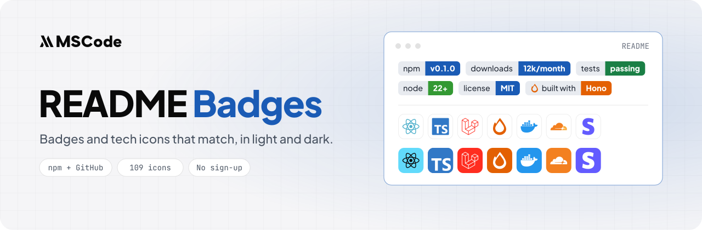

<p align="center">
  <picture>
    <source media="(prefers-color-scheme: dark)" srcset=".github/banner-dark.svg">
    
  </picture>
</p>

<p align="center">
  <a href="https://github.com/mscode-pl/badges/actions/workflows/ci.yml"></a>
  <a href="https://github.com/mscode-pl/badges"></a>
  
  <a href="LICENSE"></a>
</p>

<p align="center">
  Badges and tech icon rows for your README, in light and dark.<br>
  Static and live npm, Packagist and GitHub badges, profile buttons and 100+ icons, drawn as vector paths so they look the same everywhere.
</p>

<p align="center">
  <a href="https://badges.mscode.pl"><b>badges.mscode.pl</b></a> ·
  <a href="#badges">Badges</a> ·
  <a href="#icons">Icons</a> ·
  <a href="#options">Options</a> ·
  <a href="#run-it-yourself">Run it yourself</a>
</p>

---

## Why

shields.io and skillicons.dev are great, but they come in two different looks, and skillicons has no Hono, Caddy, Traefik, GoLand, Stripe, Strapi, Przelewy24 or InPost. Here badges, buttons and icons share one style, every badge has a light and a dark variant for `<picture>`, and the text is drawn as paths, so widths are exact and nothing gets clipped on machines without the fonts.

## Badges

The page at [badges.mscode.pl](https://badges.mscode.pl) has a badge maker and every badge with Markdown to copy.

| Badge | URL |
|---|---|
| Static | `/badge/<label>/<message>/<color>`, e.g. `/badge/node/22+/339933` |
| npm version, downloads, license | `/npm/v/<package>`, `/npm/dm/<package>` (also `dw`, `dy`), `/npm/l/<package>` |
| Packagist version, downloads, license | `/packagist/v/<vendor>/<package>`, `/packagist/dt/...` (also `dm`, `dd`), `/packagist/l/...` |
| GitHub Actions | `/github/actions/<owner>/<repo>/<workflow file>?branch=master` |
| GitHub stars, license | `/github/stars/<owner>/<repo>`, `/github/license/<owner>/<repo>` |

In static badges `_` is a space and `__` an underscore. When an upstream API fails, the badge says `unknown` instead of breaking the image.

## Icons

```html
<picture>
  <source media="(prefers-color-scheme: dark)" srcset="https://badges.mscode.pl/icons?i=react,ts,hono&theme=dark">
  
</picture>
```

Ids follow skillicons (`ts`, `py`, `postgres`, `idea`) and accept Simple Icons slugs as aliases. `perline=` wraps the row, 15 by default.

## Options

| Query | Effect |
|---|---|
| `theme` | `light` (default for badges) or `dark` (default for icons) |
| `style` | `flat` (default) or `button`; `for-the-badge` works too |
| `color`, `labelColor` | Hex without `#`, or a name such as `blue`, `green`, `red`, `orange`, `gray` |
| `label` | Replaces the label; `label=` drops it |
| `icon` | An icon id; `logo` works too |

## Run it yourself

```bash
pnpm install
pnpm dev        # http://localhost:8787
pnpm test
pnpm deploy     # needs a Cloudflare account
```

Set `GITHUB_TOKEN` with `wrangler secret put GITHUB_TOKEN` to lift the GitHub API rate limit. A token with no scopes is enough for public repositories.

To add icons, edit the list in `scripts/build-icons.mjs` and run `pnpm icons`. `pnpm banner` redraws the README banners from the live service.

## License

MIT. Badges are free to use anywhere, no attribution needed.

## Credits

Badge fonts: [Plus Jakarta Sans](https://github.com/tokotype/PlusJakartaSans) and [JetBrains Mono](https://github.com/JetBrains/JetBrainsMono), copies in `fonts/`. Page fonts: [Geist](https://github.com/vercel/geist-font) and [Outfit](https://github.com/Outfitio/Outfit-Fonts), copies in `public/fonts/`. All under the SIL Open Font License. Brand icons: [Simple Icons](https://simpleicons.org), CC0. PHP, Visual Studio Code, LinkedIn and InPost logos from Wikimedia Commons (public domain), Przelewy24 from przelewy24.pl, sources in `icons/brand/`. Logos remain trademarks of their owners.

---

<p align="center">
  <a href="https://mscode.pl">
    <picture>
      <source media="(prefers-color-scheme: dark)" srcset=".github/mscode-logo-white.svg">
      
    </picture>
  </a>
</p>

<p align="center">
  Built and maintained by <a href="https://mscode.pl">MSCode</a>, a Polish software house that makes websites and web and mobile apps.
</p>

<p align="center">
  <a href="https://mscode.pl">mscode.pl</a> · <a href="https://github.com/mscode-pl">More packages</a> · <a href="https://github.com/mscode-pl/badges/issues">Report an issue</a>
</p>
